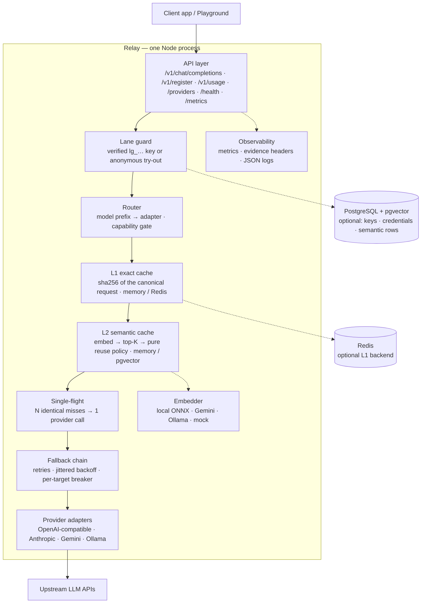

# Relay — LLM Gateway with Semantic Caching

An OpenAI-compatible gateway that sits between your app and LLM providers (OpenAI, Anthropic, Gemini, Ollama, OpenRouter) and **cuts cost and latency by serving repeated or rephrased questions from cache — without ever returning a wrong answer.**

The problem it solves: every repeated or paraphrased prompt sent to an LLM costs money and time. Naive caching is risky, because *similar* doesn't mean *equivalent*. Relay reuses an answer only when it can prove reuse is safe — and every reply carries headers showing exactly why it was a hit or a miss.

## How it works

Every chat request flows through one pipeline:

```
client request
  → validate (bad input is rejected here, before spending a cent)
  → exact cache lookup (identical question asked before? serve it, $0)
  → semantic lookup (paraphrase of a known question + safety checks pass? serve it, $0)
  → provider call (only on a genuine miss)
  → normalize + store the answer for next time
  → reply with evidence headers
```

Two safety nets keep caching honest: up to 50 identical requests arriving at once trigger only **one** provider call (single-flight), and a pure policy function re-checks provider, model, temperature, tenant identity, system-prompt fingerprint, policy version, and the similarity threshold before any paraphrased answer is reused.

## Architecture

One process, layered like a ports-and-adapters app: HTTP at the edge, pure policy in the core, every external system behind a typed port. `src/server.ts` is the composition root — the only place that decides which concrete implementations are wired.



- **Edge (`src/api/routes/`)**: Fastify routes with HTTP concerns only — validation, evidence headers, SSE framing, error vocabulary. No provider SDKs here.
- **Core ports (`src/auth`, `src/cache`, `src/embeddings`, `src/providers`, `src/policy`)**: interfaces with swappable implementations (memory / Redis / PostgreSQL; mock / API / ONNX). The reuse decision is a pure function, testable without a network.
- **Serving path**: validate → lane guard → model-prefix routing → capability gate → L1 → L2 → single-flight → fallback chain. Answers are normalized *before* they enter either cache, so a cached reply and a live reply are byte-identical.
- **Safety invariants**: anonymous try-outs never read or write cache; semantic reuse re-checks tenant, provider, model, temperature, system fingerprint, policy version and threshold; one circuit breaker per target; cache/embedder failures degrade to `MISS`, never to a 5xx.

## What it does

- **Chat, OpenAI-style** — `POST /v1/chat/completions` accepts the familiar `model`, `messages`, `temperature`, `max_tokens`, and `stream` fields, answers in the OpenAI shape, and translates provider failures into one clean error vocabulary (`400`/`429`/`502`/`504`). Streaming arrives as Server-Sent Events and survives client disconnects. Requests are lane-gated: a registered `Authorization: Bearer lg_…` key unlocks caching and accounting, while the anonymous try-out lane (`x-provider-key`) needs no signup but always bypasses the cache. Every reply carries lane + cache evidence headers (`x-lane`, `x-key-id`, `x-cache`, …).
- **Exact cache (free repeats)** — ask the identical question twice and the second answer comes from cache in milliseconds: nothing is re-sent to the provider. Formatting noise (whitespace, key order) doesn't fool it, while any real change (model, prompt, temperature) correctly misses.
- **Semantic cache (free paraphrases)** — ask the same thing in different words and, when similarity is high and every safety check passes, you get the cached answer with a similarity score in the headers. Cross-tenant, cross-model, and temperature-drifted prompts never reuse.
- **Built-in embedder — no keys, no services** — `EMBEDDING_PROVIDER=local` runs a quantized ONNX sentence-transformer (`all-mpnet-base-v2`, 768-d) in-process: real paraphrase matching with no API key and no Ollama, fully offline after the one-time model download (baked into the Docker image). Measured paraphrase cosine ≈ 0.91 vs ≈ 0.18 for unrelated prompts.
- **Five providers, one interface** — OpenAI, Anthropic, Gemini, Ollama, and OpenRouter behind a single adapter shape, with per-model routing (`gpt-*`, `claude-*`, `gemini-*`, `llama*`, free-tier `:free` models). New providers plug into the factory without touching the HTTP layer.
- **Stampede protection** — 50 identical requests landing at the same instant cause exactly one provider call; everyone shares the answer.
- **Self-service access** — `POST /v1/register` takes a provider + upstream key, stores the key encrypted, and returns a one-time `lg_` gateway key. Registered keys are the production lane: caching, per-tenant accounting, and `GET /v1/usage` for your own numbers. Dev can also seed keys via `GATEWAY_API_KEYS`.
- **Built-in observability** — hit/miss counters, hit rate, avoided provider calls, and latency averages on `GET /metrics`; liveness on `/health`; provider status on `/providers`; plus a point-and-click playground UI.

## Quickstart

Prerequisites: Node.js 20+ (CI and the Docker image run 24).

```bash
npm install
cp .env.example .env   # optional: every variable is documented there
npm run dev        # serves http://localhost:3000 (mock provider, zero setup)
```

Register an app, then chat with the issued key (first call is a MISS, the repeat is a HIT — verified live):

```bash
# 1) one-time signup: provider + upstream key -> lg_… gateway key
curl -s -X POST localhost:3000/v1/register \
  -H 'Content-Type: application/json' \
  -d '{"name":"demo","provider":"mock","provider_key":"unused-for-mock"}'
# -> {"tenant_id":"…","provider":"mock","key":"lg_…","key_prefix":"lg_ab12c"}

# 2) chat with the key from step 1
GATEWAY_KEY=lg_…   # paste it here
curl -s -X POST localhost:3000/v1/chat/completions \
  -H 'Content-Type: application/json' \
  -H "Authorization: Bearer $GATEWAY_KEY" \
  -d '{"model":"mock-model","messages":[{"role":"user","content":"What is the capital of France?"}]}' \
  -D - -o /dev/null | grep -i 'x-cache'
# x-cache: MISS   (repeat the call → x-cache: HIT)

# no key yet? the anonymous try-out lane works too — always BYPASS, never cached
curl -s -X POST localhost:3000/v1/chat/completions \
  -H 'Content-Type: application/json' -H 'x-provider-key: tryout' \
  -d '{"model":"mock-model","messages":[{"role":"user","content":"hello"}]}' \
  -D - -o /dev/null | grep -i 'x-cache'
# x-cache: BYPASS
```

### Run with Docker

The image builds reproducibly (Node 24 Debian slim, non-root, `HEALTHCHECK` on `/health`), with the default embedding model baked in — set `EMBEDDING_PROVIDER=local` and semantic caching works fully offline with zero downloads. CI builds + boots it on every push and publishes it on every main push, so you can pull instead of building:

```bash
docker pull ghcr.io/ahmedabdelgelel/relay:latest
docker run --rm -p 3000:3000 ghcr.io/ahmedabdelgelel/relay:latest

# or build it yourself
docker build -t relay .
docker run --rm -p 3000:3000 relay
```

Configuration works the same as above: pass `-e KEY=VALUE` flags or `--env-file .env` (`.env.example` documents every variable; `PORT` is honored).

| Endpoint | Method | Notes |
|---|---|---|
| `/v1/chat/completions` | POST | Chat. Registered key (`Bearer lg_…`) → caches + accounting; `x-provider-key` → anonymous try-out (BYPASS). Reply carries `x-lane`, `x-key-id`, `x-cache` (`HIT`/`SEMANTIC_HIT`/`MISS`/`BYPASS`), `x-cache-hash`, and latency evidence. |
| `/v1/register` | POST | Open signup: `{name, provider, provider_key}` → one-time `lg_` gateway key (stored hashed, shown once). |
| `/v1/usage` | GET | The caller's own request/cache numbers (registered keys only). |
| `/health` | GET | Liveness + backend wiring (no secrets). |
| `/metrics` | GET | Global counters, hit rate, avoided calls, latencies. |
| `/providers` | GET | Configured providers (never key values). |
| `/` | GET | Playground UI. |

Every variable, with its default, is listed in [`.env.example`](.env.example). The highlights (`src/infrastructure/config.ts` is the only file that reads env; typos fail fast at boot):

| Variable | Default | Purpose |
|---|---|---|
| `PORT` / `PROVIDER` | `3000` / `mock` | Port and default provider (`mock` needs no keys) |
| `GEMINI_API_KEY`, `OPENAI_API_KEY`, `ANTHROPIC_API_KEY`, `OPEN_ROUTER_KEY`, `OLLAMA_BASE_URL` | — | Only the providers you route to need keys; OpenRouter `:free` models are $0 but still need a (free) account key |
| `REDIS_URL` | — (in-memory LRU) | Exact-cache backend |
| `CACHE_TTL_S` / `CACHE_ENABLED` | `3600` / `true` | Exact-cache TTL and switch |
| `EMBEDDING_PROVIDER` / `SEMANTIC_THRESHOLD` / `SEMANTIC_TOP_K` | `mock` / `0.92` / `3` | Embedder (`local` = built-in ONNX: no key, no server), paraphrase-similarity cutoff, candidate count |
| `SEMANTIC_STORE` / `DATABASE_URL` | `memory` / — | `pgvector` for production |
| `GATEWAY_API_KEYS` / `CRED_ENC_KEY` | — | Dev seed keys (`tenant:provider:name:key`); encryption key for stored provider credentials |

## Control plane UI

Two UIs ship in this repo — one zero-build console, one full app:

- **`web/` (recommended) — Next.js control plane.** A TypeScript + Next.js 16 (App Router) app: playground with streaming chat and cache-evidence rendering, live request inspector, cache control room, and provider status. It talks to the gateway through a same-origin proxy (`GATEWAY_URL`, default `http://localhost:3000`) — no CORS setup, no keys in the bundle.

  ```bash
  cd web && npm install
  npm run dev          # http://localhost:3001 (start the gateway first)
  ```

  See [`web/README.md`](web/README.md) for scripts, architecture, and tests.

- **`public/` — the original zero-build console**, served by the gateway itself; kept unchanged for parity and its test contracts.

Both speak the same gateway contract. A registered `lg_…` key unlocks caching and accounting; the anonymous try-out lane (`x-provider-key`) needs no signup but always bypasses the cache — the UI sends it automatically when no key is configured, so a fresh checkout can send a first request immediately.

## Test report

Full suite green at the last verified run (2026-10-17): **20 files passed, 4 skipped (24 total)** — **266 tests passed, 11 skipped, 0 failed (277 total)** — plus a clean `tsc` typecheck. The default sweep is an HTTP-level end-to-end suite (108 tests that drive the real Fastify app via `app.inject()` and real sockets, with upstreams replaced by local fakes) plus focused keepers that guard what an HTTP test cannot reach: type contracts, the reuse-policy matrix, normalizer rules, SQL/Redis command builders, the ONNX embedder, the key lifecycle, and the jsdom UI suites. The four skipped files are the opt-in live tests: real OpenRouter free-tier models via `npm run test:live` (needs a free `OPEN_ROUTER_KEY`), the built-in embedder against the real ONNX model via `EMBEDDING_LIVE_TEST=1`, real Gemini via `GEMINI_LIVE_TEST=1`, and real Redis via `REDIS_LIVE_TEST=1`. No test in the default sweep calls an external provider or needs a credential, so it stays hermetic, offline and free; CI runs the same gate on every push. Run it yourself with `npm test` / `npm run typecheck`; regenerate the semantic-threshold report with `npm run eval`.

Measured performance (mock provider with 50 ms simulated latency):

| Measurement | Result |
|---|---|
| Cached reply (HIT, n=20) | avg 0.6 ms, p95 2 ms |
| Provider reply (MISS, n=5) | avg 64.6 ms, median 61 ms |
| Provider calls avoided in that run | 20 of 25 requests |
| 50 concurrent identical misses | 1 provider call, all 50 served |
| Paraphrase of a cached answer | `SEMANTIC_HIT` + similarity header, no provider call |
| Unrelated / temperature-changed / other-tenant prompt | `MISS` (no false reuse) |
| Embedder or cache outage | request still succeeds as `MISS`, never a 5xx |

<details>
<summary>Per-file breakdown (click to expand)</summary>

| Test file | Tests | What it proves |
|---|---|---|
| `tests/e2e/lanes.e2e.test.ts` | 18 | Lane guard matrix over real HTTP: 401/403/503, key precedence, anonymous BYPASS, revoked/expired keys, register + usage contracts |
| `tests/e2e/exact-cache.e2e.test.ts` | 16 | Hash identity + evidence header, TTL, admission, LRU eviction, malformed entries, single-flight stampede and failure |
| `tests/e2e/semantic-cache.e2e.test.ts` | 18 | Paraphrase HIT + similarity, threshold, policy blocks (temperature / system / model / tenant), TTL, tenant leak-proofing, degradation, independent toggles |
| `tests/e2e/streaming.e2e.test.ts` | 10 | SSE frames + terminal usage + `[DONE]`, normalizer across chunk boundaries, pre-first-token JSON errors incl. `retry_after`, request timeout, mid-stream close, failover |
| `tests/e2e/fallback.e2e.test.ts` | 11 | Prefix routing, provider-scoped entries, retry→failover, breaker open/skip, all-open 502, anonymous never borrows env adapters |
| `tests/e2e/upstream-adapters.e2e.test.ts` | 18 | Adapter wire contracts vs local fake upstreams: request bodies, headers, error maps, `stream_options` retry, credential resolution matrix |
| `tests/e2e/platform.e2e.test.ts` | 13 | health/providers/metrics hygiene, playground statics + CORS + traversal guard, validation matrix, capability gate, config invariants, real-socket boot + client-abort |
| `tests/e2e/long-context-cache.e2e.test.ts` | 4 | Multi-KB payloads, eviction absorption, hash stability (see the long-context section) |
| `tests/eval-numbers.test.ts` | 6 | Threshold sweep + determinism + latency numbers |
| `tests/types/types.test.ts` | 12 | Type-level contracts |
| `tests/contract/api-key-store.test.ts` | 21 | Key lifecycle: issue, verify, revoke, rotate, expire |
| `tests/unit/chat-ui.test.ts` | 35 | Playground UI behavior (jsdom) |
| `tests/unit/control-plane-smoke.test.ts` | 14 | Health/metrics/providers wiring |
| `tests/unit/response-normalizer.test.ts` | 23 | Markup stripping rules |
| `tests/unit/semantic-reuse.test.ts` | 17 | Policy reason matrix |
| `tests/unit/pgvector-sql.test.ts` | 11 | SQL contract for pgvector |
| `tests/unit/local-embedding.test.ts` | 7 | Built-in embedder: lazy load, retry-on-failure, dim/NaN guards |
| `tests/unit/redis-commands.test.ts` | 4 | Redis command surface |
| `tests/integration/playground-send.test.ts` | 4 | Playground send + CORS/path guards |
| `tests/integration/ui-live.test.ts` | 4 | Playground against a real server |
| `tests/integration/openrouter-live.test.ts` | 3 | Real OpenRouter free-tier upstream (opt-in via `test:live`, skipped) |
| `tests/integration/gemini-live.test.ts` | 3 | Real Gemini upstream (manual opt-in, skipped) |
| `tests/integration/embedding-live.test.ts` | 2 | Real built-in ONNX embedder (opt-in, skipped) |
| `tests/integration/redis-live.test.ts` | 3 | Real Redis round-trip (opt-in, skipped) |

</details>

## Known limits

What is deliberately not built yet is tracked in the repo docs, not hidden here — see `agent/implementation.md` Part A (Non-Goals) and the open tasks in `agent/loop.md` §Tasks. The headline items:

- **Anonymous lane never caches** — a try-out credential (`x-provider-key`) always bypasses both caches and has no tenant accounting; production traffic should register a gateway key. There are no rate limits or quotas yet, so keep the gateway behind your own network edge.
- **Ops gaps** — no Prometheus/tracing export; single process only (in-memory single-flight; cache caps: 1000 exact entries, 2000 semantic entries). CI runs typecheck + the offline test sweep and the image leg (docker build + boot + `/health`); main pushes publish `ghcr.io/ahmedabdelgelel/relay:latest`, so `docker pull` works without a local build.
- **Storage defaults** — the zero-setup path keeps gateway keys and provider credentials in memory; set `DATABASE_URL` (+ `CRED_ENC_KEY`) to move keys/credentials and the semantic store to PostgreSQL/pgvector.
- **Embedding model download** — outside the Docker image (where it is baked in), the first `local` embed downloads ~109 MB into `./.cache`, then runs fully offline. With the local embedder use `SEMANTIC_THRESHOLD` 0.80–0.85; the shipped `0.92` default was calibrated on the controlled eval distribution (`npm run eval`).
- **Provider prompt-cache discounts** (`cached_tokens`) are not surfaced; `estimated_cost_saved` is only as accurate as the `SAVED_USD_PER_1K_TOKENS` price you set.

## Layout

```
src/
  api/routes/      HTTP only (chat, register, usage, providers, playground)
  auth/            gateway keys, encrypted credentials, lane guard
  providers/       one adapter interface + factories + capability gate
  cache/           exact cache, vector stores, single-flight
  embeddings/      mock / gemini / ollama / local vector providers
  policy/          pure reuse-safety decision function
  domain/          types, canonicalization, response normalization
  observability/   metrics snapshot, JSON logger
  infrastructure/  config (all env parsing), error mapping
  server.ts        composition root (wiring lives only here)
db/migrations/     SQL schemas applied automatically at boot
scripts/eval/      deterministic threshold-sweep harness (`npm run eval`)
evaluation/        generated semantic-threshold report (the eval gate)
tests/e2e/         HTTP-level end-to-end suite (inject + real sockets, fake upstreams)
tests/             focused keepers (types, UI, policy, infra contracts)
agent/             product spec, architecture notes, and review checklists
public/            original zero-build control plane (served by the gateway)
web/               Next.js control-plane UI (see web/README.md)
```

## Long-context & high-cardinality cache (measured)

Two batteries prove the caching layers hold up at content sizes and
cardinalities the fixture tests never touch:

1. **In-suite (hermetic, runs on every commit)** — `tests/e2e/long-context-cache.e2e.test.ts`, 4 tests:
   6KB×40 exact pass with reconciled accounting; LRU cap-20 eviction absorbed
   by the semantic layer (0 extra provider calls); semantic cap-30 row
   eviction (victim paraphrase → MISS → re-saved → next paraphrase HIT);
   64KB canonical-hash stability (MISS→HIT, byte-identical).
2. **Live battery below** — real HTTP against the production build
   (`node dist/server.js`), cache=memory, semantic=memory-vector,
   embedder=local (built-in ONNX), threshold 0.80, default caps
   (L1 1000 / L2 2000, TTL 3600s), Node 24.

| Leg | Load | Numbers |
|---|---|---|
| Seed flood | 1200 unique ~8KB bodies (9.83 MB) | 197.6 s wall · 6.07 req/s · p50 165 ms · p95 180 ms · max 255 ms |
| Replay all | 1199 × semantic_hit + 1 × hit | 199.1 s wall · 6.03 req/s · p50 165 ms · p95 182 ms · max 344 ms |
| 30-way stampede, same 8KB prompt | 30 concurrent | 4.85 s wall · 30× semantic_hit · 0 provider calls |
| Single 256KB payload | 1 prompt | MISS 246 ms → HIT 249 ms, byte-identical |
| Short paraphrase probes | 40 probes | p50 15 ms · p95 22 ms · 39/40 semantic reuse |
| Accounting (whole battery) | 2472 requests total | provider calls **2** (0.08%) · exact misses 2471 · semantic_hits 2469 (avg sim 0.9606) · tokens_in exactly 10/req · saved $0.0741 |

Semantic similarity histogram over the 2469 semantic hits:
&lt;0.90 ×55 · 0.90–0.92 ×50 · 0.92–0.95 ×266 · ≥0.95 ×2098.

Honest notes: at ~8KB payloads the local embedding plus the cosine scan over
the live store dominates per-request cost (~165 ms at ~1k–2k rows, sustained
6 req/s); the 2000-row cap bounds that cost (oldest-first eviction, measured
in-suite). `provider_calls_avoided` counts exact + coalesced reuse only —
semantic reuse is tracked in `semantic_hits` (the savings metric includes
semantic reuse). Long near-duplicate bodies legitimately collapse into one
semantic entry: replaying 1200 slightly-varied 8KB prompts costs **zero**
extra provider calls.
