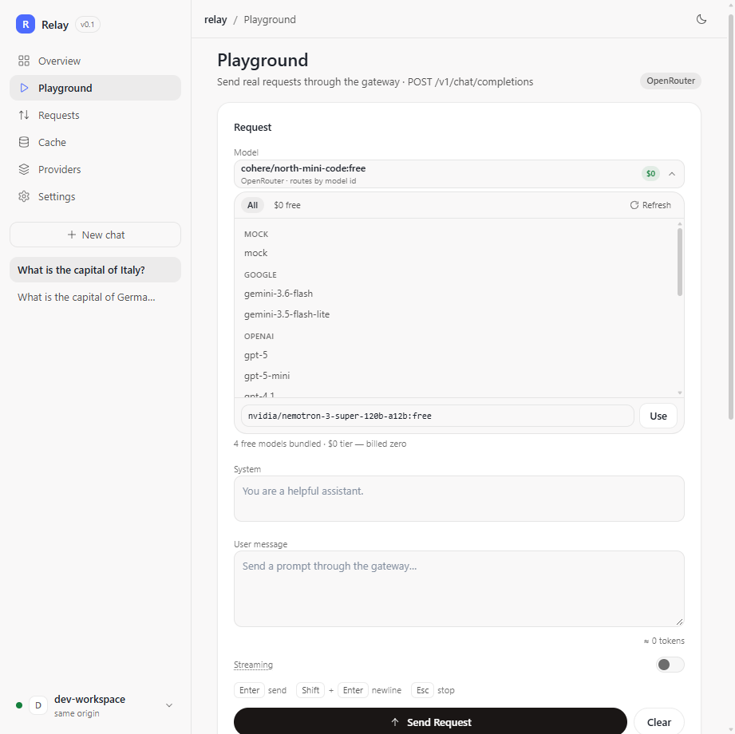
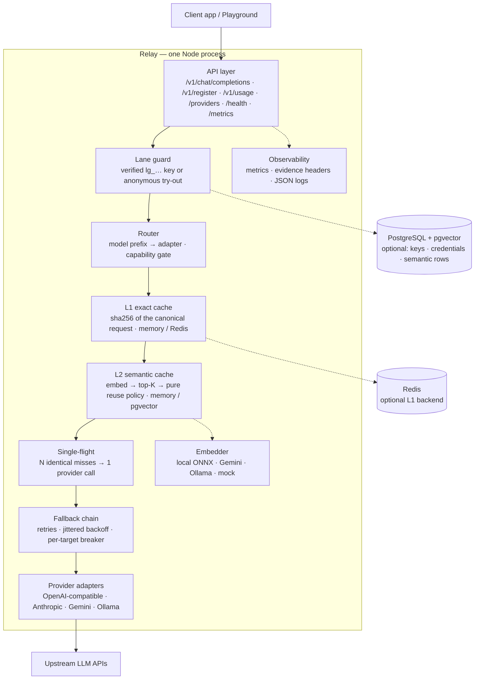

# Relay — LLM Gateway with Semantic Caching

[](https://github.com/AhmedAbdelgelel/Relay/actions/workflows/ci.yml)
[](LICENSE)
[](tests/)
[](Dockerfile)

An OpenAI-compatible gateway that sits between your app and LLM providers (OpenAI, Anthropic, Gemini, Ollama, OpenRouter) and **cuts cost and latency by serving repeated or near-duplicate questions from cache behind a measured safety gate.**

The problem it solves: every repeated or paraphrased prompt sent to an LLM costs money and time. Naive caching is risky, because *similar* doesn't mean *equivalent*. Relay reuses an answer only when its policy gate approves the match — and the real-embedding evaluation shows that safe paraphrase reuse needs more than cosine similarity, so the default threshold serves duplicate/formatting variants only.



*The Next.js control plane in simple mode: a MISS, an exact `HIT`, and a `SEMANTIC_HIT` with the measured similarity — visible for every reply, no log digging required.*

## How it works

Every chat request flows through one pipeline:

```
client request
  → lane guard (verified lg_… key or anonymous x-provider-key)
  → validate (unknown fields are rejected here, before spending a cent)
  → exact cache lookup   (same tenant + provider + canonical request? serve it, $0)
  → semantic lookup      (safe near-duplicate of a known question? serve it, $0)
  → provider call        (only on a genuine miss)
  → normalize + admit    (only non-empty successful answers enter either cache)
  → reply with evidence headers
```

**Why exact before semantic:** exact is deterministic, cheap (a hash lookup) and cannot be wrong when the identity matches; semantic is probabilistic and needs retrieval + a policy gate. Running exact first avoids an embedding call for repeats and makes the common case the fastest and safest one.

**Tenant isolation:** exact-cache storage keys are `llm:exact:v2:<tenant>:<provider>:<sha256>`. The tenant comes from the verified gateway key, never from `x-tenant-id`, so two tenants asking a byte-identical question each get their own `MISS` → own `HIT` and never share an answer. The tenant-independent `x-cache-hash` evidence header is unchanged.

Two safety nets keep caching honest: up to 50 identical requests arriving at once trigger only **one** provider call (single-flight), and a pure policy function re-checks provider, model, temperature, `top_p`/`stop` eligibility, tenant identity, system-prompt fingerprint, policy version, and the similarity threshold before any paraphrased answer is reused.

## At a glance

| | |
|---|---|
| **Cache layers** | L1 exact, tenant-scoped (canonical SHA-256, memory/Redis) · L2 semantic (768-d embeddings, memory/pgvector) |
| **Reuse safety** | pure policy gate re-checks tenant · provider · model · temperature · max_tokens · `top_p`/`stop` eligibility · system fingerprint · policy version · threshold |
| **Providers** | OpenAI, Anthropic, Gemini, Ollama, OpenRouter (one adapter interface; model-prefix routing) |
| **API surface** | explicit OpenAI-compatible subset; unknown fields are rejected with a named `400`, never silently dropped |
| **Streaming** | SSE with first-token latency, client-abort propagation, terminal usage frame, `[DONE]` |
| **Reliability** | bounded retries + jittered backoff, per-target circuit breaker, single-flight stampede protection, cache outage ⇒ `MISS` not 5xx |
| **Observability** | evidence headers on every reply (`x-cache`, `x-cache-hash`, `x-semantic-similarity`, `x-lane`, …), `/metrics`, `/health`, `/providers`, per-tenant `/v1/usage` |
| **Control plane** | Next.js 16 + React 19 UI: playground, live cache evidence, request inspector, cache control room, provider connections |
| **Verification** | 371 core tests (33 files + 4 opt-in live) · 112 UI tests · `tsc` strict · hermetic correctness + performance benchmarks · Docker + GitHub Actions CI |
| **Deploy** | Docker images for both apps (root `Dockerfile` for the gateway, `web/Dockerfile` for the UI) + one-command `docker compose up --build` |

## If you're reviewing this project

The six files that carry the interesting decisions:

1. [`src/api/routes/chat.ts`](src/api/routes/chat.ts) — the serving pipeline: lanes → validation → routing → L1 → L2 → single-flight → fallback → evidence headers.
2. [`src/policy/reuse.ts`](src/policy/reuse.ts) — the pure reuse-safety function (`similarity ≠ equivalence`).
3. [`src/cache/`](src/cache/) — exact cache, vector stores, single-flight, Redis/pgvector adapters.
4. [`evaluation/report.md`](evaluation/report.md) — deterministic controlled-embedding threshold sweep (policy math + cost model).
5. [`evaluation/real-embeddings-report.md`](evaluation/real-embeddings-report.md) — real ONNX-embedding evaluation on 233 labelled pairs: measured false positives, threshold justification and economics.
6. [`web/src/app/playground/page.tsx`](web/src/app/playground/page.tsx) — the control plane's streaming, evidence rendering and cache-verdict UX.

Security model and hardening checklist: [`SECURITY.md`](SECURITY.md).

## Architecture

One process, layered like a ports-and-adapters app: HTTP at the edge, pure policy in the core, every external system behind a typed port. `src/server.ts` is the composition root — the only place that decides which concrete implementations are wired.



- **Edge (`src/api/routes/`)**: Fastify routes with HTTP concerns only — validation, evidence headers, SSE framing, error vocabulary. No provider SDKs here.
- **Core ports (`src/auth`, `src/cache`, `src/embeddings`, `src/providers`, `src/policy`)**: interfaces with swappable implementations (memory / Redis / PostgreSQL; mock / API / ONNX). The reuse decision is a pure function, testable without a network.
- **Serving path**: validate → lane guard → model-prefix routing → capability gate → L1 → L2 → single-flight → fallback chain. Answers are normalized *before* they enter either cache, so a cached reply and a live reply are byte-identical.
- **Safety invariants**: anonymous try-outs never read or write cache; semantic reuse re-checks tenant, provider, model, temperature, system fingerprint, policy version and threshold; one circuit breaker per target; cache/embedder failures degrade to `MISS`, never to a 5xx.

## What it does

- **Chat, OpenAI-style** — `POST /v1/chat/completions` accepts the familiar `model`, `messages`, `temperature`, `max_tokens`, and `stream` fields, answers in the OpenAI shape, and translates provider failures into one clean error vocabulary (`400`/`429`/`502`/`504`). Streaming arrives as Server-Sent Events and survives client disconnects. Requests are lane-gated: a registered `Authorization: Bearer lg_…` key unlocks caching and accounting, while the anonymous try-out lane (`x-provider-key`) needs no signup but always bypasses the cache. Every reply carries lane + cache evidence headers (`x-lane`, `x-key-id`, `x-cache`, …).
- **Exact cache (tenant-scoped free repeats)** — ask the identical question twice and the second answer comes from cache in milliseconds: nothing is re-sent to the provider. Storage keys are `llm:exact:v2:<tenant>:<provider>:<sha256>`; the tenant comes from the verified gateway key, so two tenants asking byte-identical questions each get their own MISS → HIT and never share an answer. Formatting noise (whitespace, key order) doesn't fool it, while any real change (model, prompt, temperature, `top_p`, `stop`) correctly misses.
- **Semantic cache (measured, safety-first)** — near-duplicate questions (formatting/casing variants) can reuse a stored answer at the default `SEMANTIC_THRESHOLD=0.95`. The real-embedding evaluation on 233 labelled pairs found this is the zero-false-positive boundary for the built-in embedder: **at 0.92 it served 4 wrong answers (2.5% FPR)**; at 0.95 it serves duplicate/formatting pairs only (paraphrases 0/30). Real paraphrase cosines (0.74–0.95) overlap answer-changing date/number edits (up to 0.9385), so safe paraphrase reuse needs an additional lexical/date/number guard or verifier — see [`evaluation/real-embeddings-report.md`](evaluation/real-embeddings-report.md). The layer never reuses across tenant, provider, model, temperature, `max_tokens`, system fingerprint, policy version, or when `top_p`/`stop` are set.
- **Built-in embedder — no keys, no services** — `EMBEDDING_PROVIDER=local` runs a quantized ONNX sentence-transformer (`all-mpnet-base-v2`, 768-d) in-process: no API key and no Ollama, fully offline after the one-time model download (baked into the Docker image). The real-embedding report above documents its measured similarity distributions and the safety threshold.
- **Five providers, one interface** — OpenAI, Anthropic, Gemini, Ollama, and OpenRouter behind a single adapter shape, with per-model routing (`gpt-*`, `claude-*`, `gemini-*`, `llama*`, free-tier `:free` models). New providers plug into the factory without touching the HTTP layer.
- **Stampede protection** — 50 identical requests landing at the same instant cause exactly one provider call; everyone shares the answer.
- **Self-service access** — `POST /v1/register` takes a provider + upstream key, stores the key encrypted, and returns a one-time `lg_` gateway key. Registered keys are the production lane: caching, per-tenant accounting, and `GET /v1/usage` for your own numbers. Dev can also seed keys via `GATEWAY_API_KEYS`.
- **Built-in observability** — hit/miss counters, hit rate, avoided provider calls, and latency averages on `GET /metrics`; liveness on `/health`; provider status on `/providers`; plus a point-and-click playground UI.

## API compatibility

Relay implements an **explicit subset** of the OpenAI Chat Completions request surface. Fields outside the table are **rejected with `400 invalid_request` naming the field** — never silently dropped and never forwarded as a different request than the client asked for.

| Field | Type | Behavior |
|---|---|---|
| `model` | non-empty string | Required; model-prefix routing selects the provider |
| `messages` | array of `{role: system\|user\|assistant, content: string}` | Required; ≥1 message |
| `temperature` | number 0–2, default 1.0 | Forwarded to the adapter; part of cache identity/policy |
| `max_tokens` | positive integer | Forwarded; part of cache identity/policy |
| `stream` | boolean, default false | SSE path; bypasses both caches |
| `top_p` | number 0–1 | Forwarded; part of exact-cache identity; semantic reuse skipped (store cannot prove equivalence) |
| `stop` | string or 1–4 strings (≤128 chars each) | Forwarded (Anthropic `stop_sequences`); part of exact-cache identity; semantic reuse skipped |

Deliberately unsupported today: `tools`, `tool_choice`, `response_format`, `n`, `logprobs`/`top_logprobs`, `presence_penalty`, `frequency_penalty`, `seed`, and other generation fields. They return a named `400` before any provider/cache spend. Request bodies are capped at **512 KiB** (`413 payload_too_large` beyond that); the route also validates JSON shape before the lane spends anything.

## Quickstart

Prerequisites: Node.js 20+ (CI and the Docker image run 24).

```bash
npm install
cp .env.example .env   # optional: every variable is documented there
npm run dev        # serves http://localhost:3000 (mock provider, zero setup)
```

Register an app, then chat with the issued key (first call is a MISS, the repeat is a HIT — verified live):

```bash
# 1) one-time signup: provider + upstream key -> lg_… gateway key
curl -s -X POST localhost:3000/v1/register \
  -H 'Content-Type: application/json' \
  -d '{"name":"demo","provider":"mock","provider_key":"unused-for-mock"}'
# -> {"tenant_id":"…","provider":"mock","key":"lg_…","key_prefix":"lg_ab12c"}

# 2) chat with the key from step 1
GATEWAY_KEY=lg_…   # paste it here
curl -s -X POST localhost:3000/v1/chat/completions \
  -H 'Content-Type: application/json' \
  -H "Authorization: Bearer $GATEWAY_KEY" \
  -d '{"model":"mock-model","messages":[{"role":"user","content":"What is the capital of France?"}]}' \
  -D - -o /dev/null | grep -i 'x-cache'
# x-cache: MISS   (repeat the call → x-cache: HIT)

# no key yet? the anonymous try-out lane works too — always BYPASS, never cached
curl -s -X POST localhost:3000/v1/chat/completions \
  -H 'Content-Type: application/json' -H 'x-provider-key: tryout' \
  -d '{"model":"mock-model","messages":[{"role":"user","content":"hello"}]}' \
  -D - -o /dev/null | grep -i 'x-cache'
# x-cache: BYPASS
```

### Run with Docker

Everything ships as Docker images. The gateway image builds reproducibly (Node 24 Debian slim, non-root, `HEALTHCHECK` on `/health`), with the default embedding model baked in — set `EMBEDDING_PROVIDER=local` and semantic caching works fully offline with zero downloads. CI builds + boots it on every push and publishes it on every main push, so you can pull instead of building:

```bash
docker pull ghcr.io/ahmedabdelgelel/relay:latest
docker run --rm -p 3000:3000 ghcr.io/ahmedabdelgelel/relay:latest

# or build it yourself
docker build -t relay .
docker run --rm -p 3000:3000 relay
```

The control plane has its own image (the Next.js proxy target is baked in at build time):

```bash
docker build -t relay-web --build-arg GATEWAY_URL=http://host.docker.internal:3000 web/
docker run --rm -p 3001:3001 \
  -e GATEWAY_URL=http://host.docker.internal:3000 relay-web
```

**One command for the whole stack.** [`docker-compose.yml`](docker-compose.yml) builds and wires the gateway, control plane and Redis (gateway `:3000`, UI `:3001`):

```bash
docker compose up --build
# gateway  -> http://localhost:3000
# web UI   -> http://localhost:3001 (same-origin proxy to the gateway)
```

Configuration works the same as above: `docker compose` reads a local `.env` for `PROVIDER`, `OPEN_ROUTER_KEY`, `GATEWAY_API_KEYS`, `SEMANTIC_THRESHOLD`, … (`.env.example` documents every variable; `PORT` is honored). With no `.env` at all the stack starts on the mock provider, so `docker compose up --build` is a zero-key smoke test.

| Endpoint | Method | Notes |
|---|---|---|
| `/v1/chat/completions` | POST | Chat. Registered key (`Bearer lg_…`) → caches + accounting; `x-provider-key` → anonymous try-out (BYPASS). Reply carries `x-lane`, `x-key-id`, `x-cache` (`HIT`/`SEMANTIC_HIT`/`MISS`/`BYPASS`), `x-cache-hash`, and latency evidence. |
| `/v1/register` | POST | Open signup: `{name, provider, provider_key}` → one-time `lg_` gateway key (stored hashed, shown once). |
| `/v1/usage` | GET | The caller's own request/cache numbers (registered keys only). |
| `/health` | GET | Liveness + backend wiring (no secrets). |
| `/metrics` | GET | Global counters, hit rate, avoided calls, latencies. |
| `/providers` | GET | Configured providers (never key values). |
| `/` | GET | Playground UI. |

Every variable, with its default, is listed in [`.env.example`](.env.example). The highlights (`src/infrastructure/config.ts` is the only file that reads env; typos fail fast at boot):

| Variable | Default | Purpose |
|---|---|---|
| `PORT` / `PROVIDER` | `3000` / `mock` | Port and default provider (`mock` needs no keys) |
| `GEMINI_API_KEY`, `OPENAI_API_KEY`, `ANTHROPIC_API_KEY`, `OPEN_ROUTER_KEY`, `OLLAMA_BASE_URL` | — | Only the providers you route to need keys; OpenRouter `:free` models are $0 but still need a (free) account key |
| `REDIS_URL` | — (in-memory LRU) | Exact-cache backend |
| `CACHE_TTL_S` / `CACHE_ENABLED` | `3600` / `true` | Exact-cache TTL and switch |
| `EMBEDDING_PROVIDER` / `SEMANTIC_THRESHOLD` / `SEMANTIC_TOP_K` | `mock` / `0.95` / `3` | Embedder (`local` = built-in ONNX: no key, no server), similarity cutoff (0.95 = measured zero-FP boundary for local; 0.92 was the former default), candidate count |
| `SEMANTIC_STORE` / `DATABASE_URL` | `memory` / — | `pgvector` for production |
| `ALLOW_PRIVATE_PROVIDER_URLS` | `false` | Opt-in: allow tenant `base_url`s resolving to loopback/private/link-local (self-hosted Ollama). Default blocks them (SSRF hardening) |
| `GATEWAY_API_KEYS` / `CRED_ENC_KEY` | — | Dev seed keys (`tenant:provider:name:key`); encryption key for stored provider credentials |

## Control plane UI

Two UIs ship in this repo — one zero-build console, one full app:

- **`web/` (recommended) — Next.js control plane.** A TypeScript + Next.js 16 (App Router) app: playground with streaming chat and cache-evidence rendering, live request inspector, cache control room, and provider status. It talks to the gateway through a same-origin proxy (`GATEWAY_URL`, default `http://localhost:3000`) — no CORS setup, no keys in the bundle.

  ```bash
  cd web && npm install
  npm run dev          # http://localhost:3001 (start the gateway first)
  ```

  See [`web/README.md`](web/README.md) for scripts, architecture, and tests.

- **`public/` — the original zero-build console**, served by the gateway itself; kept unchanged for parity and its test contracts.

Both speak the same gateway contract. A registered `lg_…` key unlocks caching and accounting; the anonymous try-out lane (`x-provider-key`) needs no signup but always bypasses the cache — the UI sends it automatically when no key is configured, so a fresh checkout can send a first request immediately. The Next.js playground is **minimal by default**: the chat plus one compact cache verdict/hint line per reply (the only caching info a simple user needs). Settings → Advanced restores the full evidence card, request trace, session counters and metrics; `/cache` is the dedicated caching control room.

## Security

Relay is explicitly designed for two-lane access: registered `lg_…` keys get caching + accounting; anonymous try-out callers only ever use their own upstream key and never read or write cache. Exact-cache storage keys are tenant-scoped (a tenant never hits another tenant's exact entry), provider credentials are AES-256-GCM encrypted, provider error bodies are redacted before they reach clients, and tenant-supplied `base_url`s are SSRF-checked (HTTP(S) only; loopback/RFC1918/CGNAT/link-local/metadata/reserved ranges and embedded credentials rejected after DNS resolution; redirects are not followed; private/self-hosted endpoints require the explicit `ALLOW_PRIVATE_PROVIDER_URLS=1` opt-in). The full threat model, key handling, residual risks (DNS rebinding, open registration without rate limits, cached prompt data) and the deployment hardening checklist live in [`SECURITY.md`](SECURITY.md).

## Test report

Full suite green at the last verified run (**2026-10-29**): **29 files passed, 4 skipped (33 total)** — **371 tests passed, 11 skipped, 0 failed (382 total)** — plus a clean root `tsc` typecheck, and the Next.js control plane's own `lint` + `typecheck` + **112 tests (15 files)** + production `build`. The default sweep is an HTTP-level end-to-end suite that drives the real Fastify app via `app.inject()` and real sockets, with upstreams replaced by local fakes, plus focused keepers that guard what an HTTP test cannot reach: type contracts, the reuse-policy matrix, normalizer rules, SQL/Redis command builders, the ONNX embedder, key/credential lifecycle, security/tenant-isolation keepers, and jsdom UI suites. The four skipped files are the opt-in live tests: real OpenRouter free-tier models via `npm run test:live` (needs a free `OPEN_ROUTER_KEY`), the built-in embedder against the real ONNX model via `EMBEDDING_LIVE_TEST=1`, real Gemini via `GEMINI_LIVE_TEST=1`, and real Redis via `REDIS_LIVE_TEST=1`. No test in the default sweep calls an external provider or needs a credential, so it stays hermetic, offline and free; CI runs the same gate on every push. Run it yourself with `npm test` / `npm run typecheck`; regenerate the controlled threshold report with `npm run eval`, the real-embedding report with `npm run eval:real`, and the performance table with `npm run bench:perf`.

### Repeatable performance benchmark (`npm run bench:perf`)

Reproduced **2026-10-29** on Node 22, Windows 11, Intel i7-9700 (8 vCPU), 8 GB RAM (shared box): real Fastify app on a loopback socket driven by `fetch`, mock provider (2 ms; 10 ms for stampede bursts), in-memory exact/vector caches, mock embedder, 1,000 requests per scenario × 5 repeats × concurrency 1/10/50/100 (stampede bursts 50/100), warm-up before measurement. **100,750 measured requests, 491 s, 0% errors, 134/134 assertions.** Client-observed RTT (pooled):

| Scenario | n | P50 | P95 | P99 | mean req/s |
|---|---:|---:|---:|---:|---:|
| exact HIT | 20,000 | 17.98 ms | 43.16 ms | 65.32 ms | 1,645 |
| exact MISS (mock provider) | 20,000 | 30.57 ms | 55.92 ms | 74.73 ms | 1,155 |
| semantic HIT | 20,000 | 20.35 ms | 62.31 ms | 79.53 ms | 1,220 |
| unique no-cache (500-entry LRU) | 20,000 | 22.18 ms | 58.09 ms | 79.46 ms | 1,199 |
| concurrent identical (single-flight) | 750 | 40.81 ms | 58.86 ms | 70.11 ms | 1,553 |
| mixed 70/30 | 20,000 | 17.54 ms | 57.69 ms | 78.44 ms | 1,567 |

Selected per-concurrency points: exact HIT c10 P50 **4.64 ms** @1,930 rps, c50 **21.06 ms** @2,274 rps, c100 **40.40 ms** @2,294 rps; exact MISS c50 P50 26.11 ms @1,741 rps; mixed c50 P50 20.53 ms @2,211 rps. Stampede: 50 and 100 concurrent identical requests each produced **exactly 1 provider call** in all 5 runs; mixed traffic produced exactly 700 HIT / 300 MISS / 300 provider calls per run. RSS/heap are emitted per run in `BENCH_JSON` (no monotonic growth observed). **These are gateway/cache + mock-provider numbers, not real LLM latency.** `BENCH_N`, `BENCH_REPEATS`, `BENCH_CONCURRENCY`, `BENCH_SCENARIOS`, `--quick` tune the run.

### Cache-correctness benchmark (`npm run bench`)

Measured **2026-10-26** with the hermetic cache benchmark (Node 22, Windows 11, shared 8-vCPU box, mock provider with 50 ms simulated latency, real in-process ONNX embedder, no external calls). It is the correctness/accounting benchmark (44/44 hard assertions); latency numbers are lower bounds:

| Measurement | Result |
|---|---|
| Exact-cache HIT, gateway-observed `x-latency-ms` (n=20) | **avg 0.25–0.30 ms, p95 1 ms** |
| Exact-cache HIT, client loopback RTT (n=20) | avg 2.7–7.7 ms, p95 4.2–14.3 ms (Windows loopback/fetch scheduling jitter) |
| Provider MISS, client RTT (n=5) | avg 71.4–76.8 ms, median 68.8–77.6 ms (50 ms mock + real embed/overhead) |
| Provider calls avoided in that run | **20 of 25 (80%)** |
| 50 concurrent identical cold asks | **1 provider call**, 49 coalesced, all 200, same answer |
| Paraphrase of a cached answer | `SEMANTIC_HIT`, similarity **0.9103**, 0 provider calls (the benchmark runs threshold 0.80 to exercise the semantic path; that is **not** the safety recommendation) |
| Unrelated / temperature-changed / other-tenant prompt | `MISS` (no false reuse; unrelated cosine 0.1827) |
| Cache outage (throwing store on read/write) | HTTP 200 `MISS`, `cache_lookup_failed`/`cache_write_failed` counted, **no 5xx** |
| 64 KB payload | MISS 0.51–0.89 s (embedder-bound) → HIT 6–20 ms, identical `x-cache-hash` and bytes |
| 6 KB × 40 exact replay | 1 provider call for the seed, 40/40 HITs (avg 9.5–11.6 ms per replay) |
| ONNX embedder warmup | 1.0–1.2 s warm OS cache / 5.6 s cold |

How to read these: the mock provider makes this a **lower bound, not a live-provider benchmark**; MISS and large-payload requests include real in-process ONNX inference (~30 ms warm for short prompts, ~0.6 s for multi-KB prompts on this machine). HIT latency is reported both gateway-side and client loopback (the client number includes OS/fetch scheduling jitter). The reproduced run passed **44/44 hard assertions** and `/metrics` confirmed the accounting for every phase.

### Reproduce the numbers

```bash
npm install
npm run bench                      # cache correctness/accounting benchmark (44/44 assertions)
npm run bench:perf                 # 100k-request performance benchmark (~8 min; --quick for smoke)
npm run eval                       # controlled-embedding threshold sweep → evaluation/report.md
npm run eval:real                  # real ONNX-embedding evaluation → evaluation/real-embeddings-report.md
npm test                           # 371 passed, 11 skipped (33 files)
npm run typecheck
cd web && npm install && npm test  # 112 UI tests; npm run build for production
```

The performance harness lives in [`scripts/bench/perf.ts`](scripts/bench/perf.ts); the correctness benchmark in [`scripts/bench/cache.ts`](scripts/bench/cache.ts). Both boot the real Fastify app on an ephemeral loopback port (no vitest, no network). Numbers vary by a few ms run-to-run on a shared Windows box; the full run JSON is printed on every invocation.

<details>
<summary>Per-file breakdown (click to expand, counts from the 2026-10-29 run)</summary>

| Test file | Tests | What it proves |
|---|---|---|
| `tests/e2e/lanes.e2e.test.ts` | 20 | Lane guard matrix over real HTTP: 401/403/503, key precedence, anonymous BYPASS, revoked/expired keys, register + usage contracts, fallback cache discipline |
| `tests/e2e/exact-cache.e2e.test.ts` | 24 | Hash identity + evidence header, TTL, admission, LRU eviction, malformed entries, empty-response refusal, dead Redis degradation, single-flight stampede and failure |
| `tests/e2e/semantic-cache.e2e.test.ts` | 23 | Paraphrase HIT + similarity, threshold, policy blocks (temperature / system / model / tenant / policy version), TTL, tenant leak-proofing, degradation, independent toggles |
| `tests/e2e/streaming.e2e.test.ts` | 10 | SSE frames + terminal usage + `[DONE]`, normalizer across chunk boundaries, pre-first-token JSON errors incl. `retry_after`, request timeout, mid-stream close, failover |
| `tests/e2e/fallback.e2e.test.ts` | 19 | Prefix routing, provider-scoped entries, retry→failover, breaker open/skip, all-open 502, anonymous never borrows env adapters, production composition never falls back to the in-process mock, provider-specific model ids stay on their provider |
| `tests/e2e/upstream-adapters.e2e.test.ts` | 20 | Adapter wire contracts vs local fake upstreams: request bodies, headers, error maps, `stream_options` retry, credential resolution matrix |
| `tests/e2e/platform.e2e.test.ts` | 16 | health/providers/metrics hygiene, playground statics + CORS + traversal guard, validation matrix incl. malformed JSON envelope, capability gate, config invariants, real-socket boot + client-abort |
| `tests/e2e/connections.e2e.test.ts` | 8 | Per-tenant provider connections: register/connect/reconnect, BYO key + base URL routing, validation, auth, OpenRouter-free-on-keyless-gateway flow |
| `tests/e2e/long-context-cache.e2e.test.ts` | 4 | Multi-KB payloads, eviction absorption, hash stability (see the long-context section) |
| `tests/e2e/single-flight-abort.e2e.test.ts` | 2 | Waiter abort never kills shared work; leader abort still serves followers; the flight is reusable afterwards |
| `tests/e2e/tenant-cache-isolation.e2e.test.ts` | 4 | Tenant A/B exact-cache isolation: separate MISS/MISS/HIT, same-tenant HIT, no cross-tenant read |
| `tests/e2e/request-schema.e2e.test.ts` | 5 | Supported fields forward to adapters; unknown fields 400 before spend; top_p/stop identity + semantic skip |
| `tests/e2e/resilience.e2e.test.ts` | 17 | pgvector/Redis outages, timeouts, malformed JSON/SSE, large bodies, aborts, retry storms, stampedes |
| `tests/e2e/secret-redaction.e2e.test.ts` | 3 | Keys/credentials/passwords never in HTTP surfaces or logs; provider-error redaction |
| `tests/unit/base-url-security.test.ts` | 16 | SSRF policy matrix: private/metadata/ULA/DNS/credentials/opt-in |
| `tests/unit/real-embeddings-eval.test.ts` | 10 | Real-embedding dataset contract, policy/store wiring, economics and gate |
| `tests/contract/api-key-store.test.ts` | 26 | Key/credential lifecycle: issue, verify, revoke, rotate, expire, hash-only storage; pg SQL contracts; auth migrations; undecryptable-credential degradation |
| `tests/eval-numbers.test.ts` | 6 | Threshold sweep + determinism + latency numbers |
| `tests/types/types.test.ts` | 12 | Type-level contracts |
| `tests/unit/chat-ui.test.ts` | 35 | Legacy playground UI behavior (jsdom) |
| `tests/unit/control-plane-smoke.test.ts` | 14 | Legacy control-plane health/metrics/providers wiring |
| `tests/unit/response-normalizer.test.ts` | 23 | Markup stripping rules |
| `tests/unit/semantic-reuse.test.ts` | 18 | Policy reason matrix |
| `tests/unit/pgvector-sql.test.ts` | 12 | SQL contract for pgvector (migrations, scope index, upsert, tenant filter) |
| `tests/unit/local-embedding.test.ts` | 7 | Built-in embedder: lazy load, retry-on-failure, dim/NaN guards |
| `tests/unit/config.test.ts` | 5 | Numeric/boolean env parsing incl. integer validation |
| `tests/unit/redis-commands.test.ts` | 4 | Redis command surface |
| `tests/integration/playground-send.test.ts` | 4 | Playground send + CORS/path guards |
| `tests/integration/ui-live.test.ts` | 4 | Legacy playground against a real server |
| `tests/integration/openrouter-live.test.ts` | 3 (skipped) | Real OpenRouter free-tier upstream (opt-in via `test:live`; passed live on 2026-10-26) |
| `tests/integration/gemini-live.test.ts` | 3 (skipped) | Real Gemini upstream (manual opt-in) |
| `tests/integration/embedding-live.test.ts` | 2 (skipped) | Real built-in ONNX embedder (opt-in) |
| `tests/integration/redis-live.test.ts` | 3 (skipped) | Real Redis round-trip (opt-in) |

</details>

## Known limits

What is deliberately not built yet is tracked in the repo docs, not hidden here — see `agent/implementation.md` Part A (Non-Goals) and the open tasks in `agent/loop.md` §Tasks. The headline items:

- **Anonymous lane never caches** — a try-out credential (`x-provider-key`) always bypasses both caches and has no tenant accounting; production traffic should register a gateway key. There are no rate limits or quotas yet, so keep the gateway behind your own network edge.
- **Tenant isolation** — exact-cache storage keys are tenant-scoped (`llm:exact:v2:<tenant>:<provider>:<hash>`) and semantic rows are tenant-scoped + policy-checked. The tenant always comes from the verified gateway key; `x-tenant-id` is ignored.
- **Ops gaps** — no Prometheus/tracing export; single process only (in-memory single-flight; cache caps: 1000 exact entries, 2000 semantic entries; semantic eviction is insertion-order/FIFO, not LRU). CI runs typecheck + the offline test sweep and the image leg (docker build + boot + `/health`); main pushes publish `ghcr.io/ahmedabdelgelel/relay:latest`, so `docker pull` works without a local build.
- **Storage defaults** — the zero-setup path keeps gateway keys and provider credentials in memory; set `DATABASE_URL` (+ `CRED_ENC_KEY`) to move keys/credentials and the semantic store to PostgreSQL/pgvector.
- **Embedding model + semantic threshold** — outside the Docker image (where it is baked in), the first `local` embed downloads ~109 MB into `./.cache`, then runs fully offline. The shipped `SEMANTIC_THRESHOLD=0.95` is the measured zero-false-positive boundary for the built-in embedder (duplicate/formatting reuse only). Lowering it to 0.92 served 4 wrong answers (2.5% FPR) on the 233-pair real-embedding corpus; safe paraphrase reuse needs an additional lexical/date/number guard or verifier. See [`evaluation/real-embeddings-report.md`](evaluation/real-embeddings-report.md). The controlled eval (`evaluation/report.md`) still shows a 0.92 optimum for its prescribed-cosine fixtures — that validates policy math, not embedding quality.
- **BYO provider URLs** — tenant-supplied `base_url`s are SSRF-checked (private/loopback/link-local/metadata/reserved ranges + embedded credentials rejected after DNS resolution; redirects blocked) and private/self-hosted endpoints require the explicit `ALLOW_PRIVATE_PROVIDER_URLS=1` opt-in. Residual DNS-rebinding/TOCTOU risk remains; keep registration behind an authenticated edge.
- **Request size** — Fastify body limit is 512 KiB (`413 payload_too_large`); cache entries are bounded by count, not by a byte budget, so a deployment accepting large prompts should size memory accordingly.
- **Provider prompt-cache discounts** (`cached_tokens`) are not surfaced; `estimated_cost_saved` is only as accurate as the `SAVED_USD_PER_1K_TOKENS` price you set.
- **Fallback scope** — the ordered fallback chain acts on provider-agnostic model ids only. A provider-specific id (`gpt-*`, `claude-*`, `gemini-*`, `llama*`, `openrouter/*`, `*:free`) retries inside its own provider and never fails over to another vendor, because a foreign model id would 404 and mask the real upstream error (live-proven: an OpenRouter 429 surfaced as a misleading Gemini 404).
- **pgvector expiry** — rows expire logically (`expires_at` filter) and are never served after TTL, but no purge job deletes them yet; long-lived pgvector deployments should schedule their own `DELETE FROM semantic_cache WHERE expires_at < now()` until that lands.

## Roadmap (what I would do next if productizing)

- Per-tenant rate limits/quotas and an admin API (API Management / edge currently required).
- Prometheus/OpenTelemetry export + distributed tracing; latency histograms beyond the JSON snapshot.
- Multi-replica safe single-flight and circuit breaker (Redis-based lease/lock) instead of process-local state.
- Scheduled pgvector retention/purge job and a CI leg with PostgreSQL + pgvector (today the SQL/DDL is contract-tested and was manually validated against PostgreSQL 13).
- Hosted public demo (mock provider or a capped demo key) with a short screen capture, for reviewers who don't want to clone.

## Layout

```
src/
  api/routes/      HTTP only (chat, register, usage, providers, playground)
  auth/            gateway keys, encrypted credentials, lane guard
  providers/       one adapter interface + factories + capability gate
  cache/           exact cache, vector stores, single-flight
  embeddings/      mock / gemini / ollama / local vector providers
  policy/          pure reuse-safety decision function
  domain/          types, canonicalization, response normalization
  observability/   metrics snapshot, JSON logger
  infrastructure/  config (all env parsing), error mapping
  server.ts        composition root (wiring lives only here)
db/migrations/     reference SQL mirroring the runtime DDL embedded in src/ (boot applies the embedded DDL)
scripts/eval/      controlled threshold sweep (`npm run eval`) + real-embedding evaluation (`npm run eval:real`)
scripts/bench/     cache-correctness benchmark (`npm run bench`) + performance benchmark (`npm run bench:perf`)
evaluation/        generated controlled-threshold and real-embedding reports (the eval gates)
docs/              README assets (screenshots)
docker-compose.yml gateway + control plane + Redis, one command
tests/e2e/         HTTP-level end-to-end suite (inject + real sockets, fake upstreams)
tests/             focused keepers (types, UI, policy, infra contracts)
agent/             product spec, architecture notes, and review checklists
public/            original zero-build control plane (served by the gateway)
web/               Next.js control-plane UI (see web/README.md)
SECURITY.md        threat model, key handling, known limitations, hardening checklist
```

## Long-context & high-cardinality cache (measured)

Two batteries prove the caching layers hold up at content sizes and
cardinalities the fixture tests never touch:

1. **In-suite (hermetic, reproduced on every run)** — `tests/e2e/long-context-cache.e2e.test.ts`, 4 tests:
   6KB×40 exact pass with reconciled accounting; LRU cap-20 eviction absorbed
   by the semantic layer (0 extra provider calls); semantic cap-30 row
   eviction (victim paraphrase → MISS → re-saved → next paraphrase HIT);
   64KB canonical-hash stability (MISS→HIT, byte-identical).
2. **Live battery (historical, pre-hardening)** — real HTTP against a production build
   (`node dist/server.js`), cache=memory, semantic=memory-vector,
   embedder=local (built-in ONNX), threshold 0.80, default caps
   (L1 1000 / L2 2000, TTL 3600s), Node 24. Measured 2026-10-17; not re-run in
   the 2026-10-29 verification sweep. The 0.80 threshold here is a historical
   setting used to exercise the semantic path; it is **not** a safety
   recommendation (see the real-embedding report). Numbers demonstrate scale and
   latency, not the current threshold's hit rate.

| Leg | Load | Numbers |
|---|---|---|
| Seed flood | 1200 unique ~8KB bodies (9.83 MB) | 197.6 s wall · 6.07 req/s · p50 165 ms · p95 180 ms · max 255 ms |
| Replay all | 1199 × semantic_hit + 1 × hit | 199.1 s wall · 6.03 req/s · p50 165 ms · p95 182 ms · max 344 ms |
| 30-way stampede, same 8KB prompt | 30 concurrent | 4.85 s wall · 30× semantic_hit · 0 provider calls |
| Single 256KB payload | 1 prompt | MISS 246 ms → HIT 249 ms, byte-identical |
| Short paraphrase probes | 40 probes | p50 15 ms · p95 22 ms · 39/40 semantic reuse |
| Accounting (whole battery) | 2472 requests total | provider calls **2** (0.08%) · exact misses 2471 · semantic_hits 2469 (avg sim 0.9606) · tokens_in exactly 10/req · saved $0.0741 |

Semantic similarity histogram over the 2469 semantic hits:
&lt;0.90 ×55 · 0.90–0.92 ×50 · 0.92–0.95 ×266 · ≥0.95 ×2098.

Honest notes: at ~8KB payloads the local embedding plus the cosine scan over
the live store dominates per-request cost (~165 ms at ~1k–2k rows, sustained
6 req/s); the 2000-row cap bounds that cost (oldest-first eviction, measured
in-suite). `provider_calls_avoided` counts exact + coalesced reuse only —
semantic reuse is tracked in `semantic_hits` (the savings metric includes
semantic reuse). Long near-duplicate bodies legitimately collapse into one
semantic entry: replaying 1200 slightly-varied 8KB prompts costs **zero**
extra provider calls.


